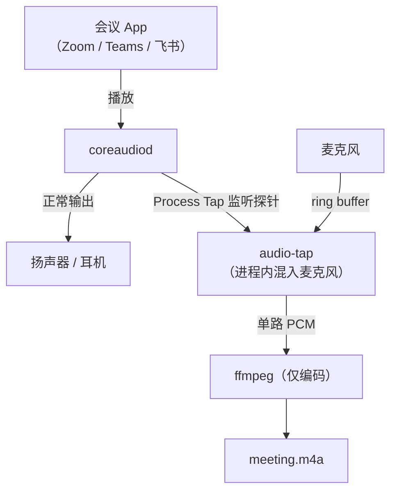
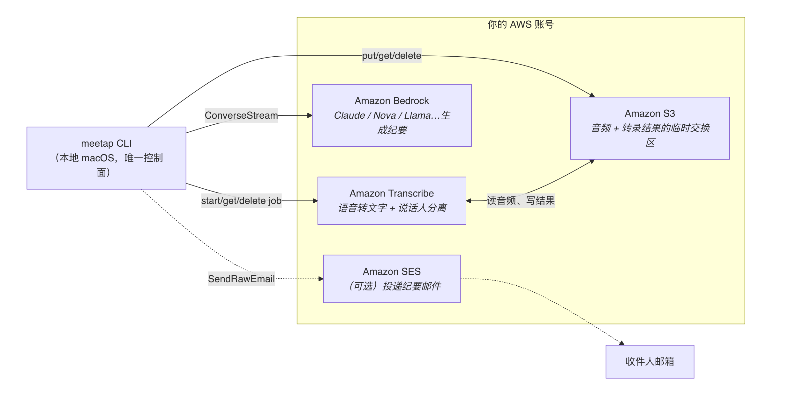
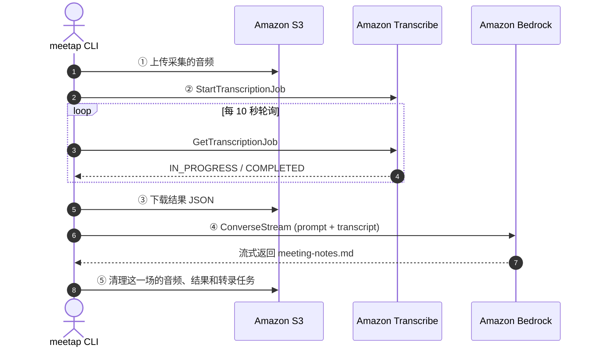

# MeeTap

> 🎙️ **MeeTap** · 一键启用，无感采集，智能纪要 —— 让 Mac 上的每一段音频自动变成结构化笔记。

**MeeTap** 是一款面向 **macOS** 的本地化智能音频转纪要工具，将"音频采集 → 转写 → 摘要"全流程自动化，让会议与学习内容一键沉淀为结构化笔记。

------


### 🔧 工作流程

1. **音频捕获** —— 使用 macOS 自带的 **Process Tap**（14.4+）直接、无感地采集系统音频，**免装虚拟声卡、不切换输出设备、不用配置会议 App**。无缝兼容 Zoom、Teams、飞书、腾讯会议等主流会议应用；
2. **语音转写** —— 音频采集结束后自动上传至 **AWS Transcribe**，输出带**说话人分离（Speaker Diarization）**的结构化文本；
3. **智能摘要** —— 通过 **Amazon Bedrock** 调用大语言模型（默认 **Claude Sonnet**，一键切换 Nova、Llama、DeepSeek 等），生成条理清晰的**中文会议纪要**。

------


### 🎯 适用场景

除在线会议外，亦可用于 **YouTube 视频、播客、线上课程、访谈录音**等任意 Mac 播放的音视频内容归档，覆盖**会议记录、学习笔记、资料整理、访谈转写**等多样化需求。

------

### ✨ 核心特性

| 特性                 | 说明                                                         |
| :------------------- | :----------------------------------------------------------- |
| 🚀 **开箱即用**       | 首次启动自动生成默认配置，零学习成本，即装即用               |
| 🎧 **免装免切换**     | 走系统自带的 Process Tap 直接采集，无需安装虚拟声卡、无需切换系统输出设备；录制时你照常从原扬声器/耳机听到原声 |
| 👻 **零侵入音频采集** | 无需以 "Bot 参会者" 身份加入会议，与会者全程无感知，规避合规风险 |
| ⏱️ **时长自停**       | `meetap start -d <分钟>` 指定会议时长上限，到点自动结束、自动转录 |
| 📊 **实时波形**       | 终端底部实时点阵波形，融合系统音 + 你的麦克风，一眼确认"确实在录、双向都有声" |
| ✍️ **智能纪要**       | Claude Sonnet 5 生成，自动按主题命名文件；可补资料、提要求 `again` 重写 |
| 📧 **专业邮件**       | 纪要自动渲染为 HTML 邮件（兼容 Outlook）+ PDF 附件，一键发给收件人 |
| 💰 **按量计费**       | 无订阅、无最低消费，一场会约几毛钱                          |
| 🔐 **数据主权**       | 所有音频与纪要仅在你**自己的 AWS 账号**内流转，不经第三方云服务；任务结束自动清理，隐私可控 |
| 🌐 **双语 CLI**       | 终端输出支持 `zh-CN` / `en-US` 切换（仅影响界面语言，**纪要内容始终为中文**） |

---


## 一、前置条件

1. **macOS 14.4+**：指 Sonoma 14.4 及之后的所有版本，涵盖 macOS 15 Sequoia、macOS 26 Tahoe
   - 2.0 起只用系统自带的 Process Tap 采集，不再支持 macOS 13；还在 13.x 上请继续用 1.x；
   - Homebrew 只能按大版本限制系统（Sonoma），所以 14.0–14.3 上也装得上，但 `meetap start` / `setup` 会直接提示版本太低、不开录。
2. **Xcode Command Line Tools**（首次安装会自动提示）
   
   ```bash
   xcode-select --install
   ```
3. **AWS 账号**，并已在 [Bedrock 控制台](https://console.aws.amazon.com/bedrock/) 的 **Model access** 开通以下任一模型（MeeTap 默认用 Claude Sonnet）：
   - Anthropic Claude Sonnet
   - Amazon Nova Pro
   - Meta Llama、Mistral、DeepSeek 等任意支持 Converse API 的模型
4. **（可选）系统日历里有你的会议**：想让纪要用上日历里的会议名、组织者、参会人和议程，就在 **系统设置 › 互联网账户** 里加上公司账户（比如 Microsoft Exchange）并勾选「日历」。刚加的账户要等十几分钟才同步完。没有也不影响录音，只是纪要里没有日历信息。

> **权限是按终端 App 给的**：系统录音和日历这两项权限，macOS 都是授给你运行 meetap 的**那个终端 App**（Ghostty、终端、iTerm 等），不是授给 meetap 本身。所以在几个终端里开录，就要**在每个终端里各跑一次 `meetap setup`**；在系统设置里改了权限，可能要**退出并重新打开那个终端 App** 才生效。

---


## 二、安装（任选一种）

### 方式 A：Homebrew Tap（推荐）

```bash
# 一次性 tap（只需做一次）
brew tap henceman777/tap

# 之后这样安装和升级
brew install meetap
brew upgrade meetap
# 自动安装依赖：ffmpeg、python
```

> 也可以一行搞定（自动 tap + install，但命令较长）：
> ```bash
> brew install henceman777/tap/meetap
> ```

### 方式 B：从源码构建

```bash
# 1. 装依赖
brew install ffmpeg awscli

# 2. clone & 编译安装
git clone https://github.com/henceman777/meetap.git
cd meetap
make install     # 编译 audio-tap / audio-multi-output 并装到 ~/bin
```

> **关于音频权限**：Process Tap 首次采集会触发 macOS 的"系统音频录制"授权。`make install` 已为 `audio-tap` 嵌入权限描述并重新签名；首次运行 `meetap setup` 会检测并引导你完成授权。


### 从 1.x 升级到 2.0（必看）

2.0 起只用 macOS 自带的 **Process Tap** 采集，**不再使用 BlackHole**，也不再需要给会议 App 配扬声器；系统要求随之提高到 **macOS 14.4+**。

```bash
brew upgrade meetap        # 或源码安装：cd meetap && git pull && make install
meetap setup               # 升级后先跑一次
```

`meetap setup` 会做三件事（在几个终端里开录，就在每个终端里各跑一次）：

1. **检查从 1.x 留下的音频设置**（只在需要时出声）：
   - **系统输出还停在 `BlackHole 2ch` 上**（以前录音崩溃后没恢复）：知道原来用的设备、它也还连着，就自动切回并告诉你切到了哪个；不知道的话列出设备让你选，默认「保持不变」——你可能是有意给别的软件用的。`meetap start` 开录前也会做同样的检查，但不会因此不开录。
   - **Zoom 的扬声器还设成了 BlackHole**：提示你在 Zoom › 设置 › 音频 › 扬声器 里改回「与系统相同」。只提示，不改 Zoom 的配置。
   - **系统里还装着 BlackHole**：提醒你检查 Teams、腾讯会议的扬声器是不是还选着 BlackHole 2ch（以前的 `setup` 让你这样选过），是的话改回系统默认或你的扬声器、耳机。
2. **检查系统录音授权**（Process Tap）：做一次 2 秒实测（会播一声提示音）；如果录到静音，就打开 **系统设置 › 隐私与安全性 › 屏幕与系统录音**，引导你把终端 App（Ghostty / Terminal / iTerm 等）加进"仅系统录音"并复测。1.5.0 以前一直走 BlackHole 的用户从没授过这项权限，这一步必须做；部分终端（如 Ghostty）不会自动弹授权框，要手动添加。
3. **日历授权（可选）**：见下文「日历里的会议信息」。拒绝也不影响录音。

另外：

- **BlackHole 可以卸载**：`brew uninstall --cask blackhole-2ch`。2.0 不再用它，卸不卸由你定——别的软件还在用的话就留着。卸载后驱动文件就删了，但设备列表里可能还挂着 `BlackHole 2ch`，要重启电脑（或 `sudo killall coreaudiod`）才会消失；在那之前别把它选成输出设备，`meetap setup` 也会这样提示。
- **配置里的 `audio_capture = blackhole` 可以删掉**：2.0 起这一项不起作用，录音照样走 Process Tap，`start` / `setup` 会提示一句。
- `meetap setup-zoom` / `setup-teams` / `setup-wemeet` 只会提示"2.0 起不需要配置会议 App 的扬声器"。
- 授权没生效时没有别的采集方式可以退，会录成静音。所以 2.0 加了**静音报警**：录音期间只要有 App 在放声音、录到的却全是零，30 秒内弹通知（见「日常使用」）。
- 还在 macOS 13.x 上：2.0 用不了（`start` / `setup` 会报版本太低），请继续用 1.x。

---


## 三、一次性配置

### 1. 配置 AWS CLI

```bash
aws configure
# 输入 Access Key / Secret / region（us-east-1 或其他开通了 Bedrock 的区域）
```

确保你的 AWS 账号具备以下权限（完整清单见附录）：`s3:PutObject/GetObject/DeleteObject`、`transcribe:*TranscriptionJob`、`bedrock:InvokeModelWithResponseStream`、（可选 SES 发邮件）`ses:SendRawEmail`。

### 2. 录音和日历授权（每个终端各一次）

```bash
meetap setup
```

- **检测并引导 Process Tap 授权**——`setup` 会做一次 2 秒实测；若为静音，会自动打开 系统设置 › 隐私与安全性 › 屏幕与系统录音，引导你把终端 App 加进"仅系统录音"，按提示复测。这是唯一需要的一次性准备。
- **检查从 1.x 升级留下的音频设置**——系统输出、Zoom / Teams / 腾讯会议的扬声器是不是还指着 BlackHole，详见上文「从 1.x 升级到 2.0」。会议 App 的扬声器不需要任何配置：Process Tap 采集整个系统混音，与会议 App 的扬声器设置无关。
- **日历授权（可选）**——还没授权时，说明用途后请求一次（会弹授权框），拒绝也算通过。整个 meetap 只有 `setup` 会请求日历授权，开录、停止、休眠自动停止、后台录音都不会弹框，只在已经授权时读。如果只有「写入」权限（读不到会议），`setup` 会写明去 **系统设置 › 隐私与安全性 › 日历** 把当前终端 App 改成「完全访问」，改完可能要重开终端。

权限是授给终端 App 的：**换了终端 App、或在另一个终端里开录，就在那个终端里再跑一次 `meetap setup`**；在系统设置里改了权限后，可能要退出并重新打开那个终端 App 才生效。

### 3. （可选）修改默认配置

首次运行 `meetap` 任何命令时，会自动在 `~/.config/meetap/config` 生成一份默认配置。要改的话：

```bash
meetap config           # 在 $EDITOR 里打开配置文件
meetap config show      # 查看当前所有配置项
```

关键配置项说明：

| 字段 | 默认 | 说明 |
|---|---|---|
| `region` | `us-east-1` | AWS 区域（影响 S3 / Transcribe / Bedrock） |
| `model` | `global.anthropic.claude-sonnet-5` | 纪要生成使用的 Bedrock 模型 ID |
| `transcribe_languages` | `en-US zh-CN ja-JP` | Transcribe 候选语言（按优先级） |
| `multi_language` | `false` | 同一会议中英混讲时改 `true` |
| `language` | `zh-CN` | CLI 界面语言（en-US 或 zh-CN）—— **不影响纪要** |
| `email` | 空 | 纪要收件人，留空则跳过邮件 |
| `email_sender` | 空 | SES 已验证的发件人，设了 email 必填 |
| `zero_alert_ignore` | `com.amazon.workspaces` | 静音报警时不算"在放声音"的 App（逗号分隔的 bundle ID 或命令行程序名），见下 |
| `calendar` | `on` | 停止录音后读系统日历补充会议信息（`on` / `off`），`off` 时完全不碰日历，见「日历里的会议信息」 |

**`zero_alert_ignore` 是干什么的**：录音期间如果有 App 在放声音、录到的却全是零（多半是系统录音授权失效，或系统采集中途出了故障），meetap 会在 30 秒内弹通知，写明是哪个 App 在放。有的 App 一直开着音频输出、其实放的是静音（比如 Amazon WorkSpaces 客户端），会被误当成"在放声音"，每次提前开录都误报，所以要排除掉。**什么时候往里加**：收到这条通知、但当时其实没有任何声音在放，就把通知里那个 App 后面**括号里那一串**加进来——通知写的是"显示名（bundle ID）"，比如"Google Chrome（com.google.Chrome.helper）"，要加的是 `com.google.Chrome.helper`；命令行程序没有括号，直接加程序名。多个用逗号隔开。名单里的 App 只是不再触发报警，会话的 `.meetap/audio-tap.log` 里照样记（`ignored=`）。

重置为默认：`rm ~/.config/meetap/config` 后再跑任意 `meetap` 命令。

---


## 四、日常使用

整个工作流只有两行命令：

```bash
meetap         # 开会前或开会过程中随时可以敲（等同 meetap start）；终端底部显示波形
               # 会议结束按 Ctrl-C（等同 meetap stop）：自动转录 + 生成纪要
```

只敲 `meetap`、不带任何参数，就等同 `meetap start`。开录选项也可以直接跟在 `meetap` 后面：`meetap -m -d 60` 等同 `meetap start -m -d 60`（只认 `-t`、`-d`、`-b`、`-m` 和它们的长写法）。要给会议起名仍写 `meetap start 周会`；`meetap 周会` 这类写法会报「未知命令」，不会开录，免得敲错字误开录音。查看所有命令用 `meetap help`。

`meetap start` 默认在前台运行、占用当前终端。想继续用这个终端，加 `-b` 在后台运行，结束时再敲 `meetap stop`。前台模式下录音期间关闭终端窗口，也会像 `stop` 一样正常收尾（`-b` 模式关窗口不会收尾，录音继续）。

> **注意**：从 v1.7 起 `meetap start` 默认前台运行并阻塞终端。在脚本、alias、shell 函数、快捷指令里调用 `meetap start` 并希望立即返回的（如 `meetap start x && open zoommtg://...`），请改用 `meetap start -b`。

### 开始音频采集

```bash
$ meetap start

🎙️  录制已开始
   播放: MacBook Pro Speakers (Process Tap)
   停止录制: Ctrl-C（或在其他终端运行 /Users/you/bin/meetap stop）
   自动停止: 关闭（手动 stop 结束）
```

想让会议到点自动结束，加 `-d` 指定分钟数：

```bash
$ meetap start -d 60

🎙️  录制已开始
   播放: MacBook Pro Speakers (Process Tap)
   停止录制: Ctrl-C（或在其他终端运行 /Users/you/bin/meetap stop）
   自动停止: 60 分钟后（约 15:30）
```

录网页直播、线上分享这类只需要电脑声音的场景，现场环境声会干扰转录，加 `-m` 只录系统音：

```bash
$ meetap start -m -d 150

🎙️  录制已开始
   播放: MacBook Pro Speakers (Process Tap)
   麦克风: 已静音（只录系统音）
   停止录制: Ctrl-C（或在其他终端运行 /Users/you/bin/meetap stop）
   自动停止: 150 分钟后（约 17:00）
```

加了这个选项，麦克风全程不打开，菜单栏不会亮橙点，AirPods 也不会被切到通话音质。选项写在会议名前后都行；`-m`、`--mute-mic`、`--mute-microphone` 三种写法等价。如果整段录音都是静音（比如没授权系统音频录制），`stop` 之后不会上传转录，音频会留在本地，并弹通知提醒你。

音频采集期间：

- **你正常开会**，音频照常从原来的扬声器 / 耳机里播放（Process Tap 不切换输出设备，录音中途切换输出设备也不影响采集）
- **终端底部**会显示音量电平 + 时长（`-m` 时只跟电脑声音走）
- 指定了 `-d` 时，到达时长上限会自动停止；否则一直录到你手动 `stop`
- **有声音在放、却录成静音时当场提醒**：整场录音期间，只要有 App 在放声音、录到的却全是零，30 秒内弹系统通知，写明是哪个 App 在放（"显示名（bundle ID）"，比如"Google Chrome（com.google.Chrome.helper）"）。开会前提前开录、什么都没在放时不会提醒。每段变零、恢复的墙钟时间都记在会话的 `.meetap/audio-tap.log` 里（`TAP_ZERO_START` / `TAP_ZERO_END`），开着麦克风的场次也记
- **Mac 休眠（合盖等）时自动结束本场录音**：只把音频文件收尾，不在休眠前上传转录；唤醒后会弹通知，按提示运行 `meetap again <会话名>` 生成纪要（`meetap status` 也会显示这条待办）。锁屏、显示器休眠不受影响

### 停止 + 自动生成纪要

```bash
$ meetap stop

⏳ 等待录制完成...
✅ 音频采样成功
📝 后台转录已启动（完成后会收到通知）
```

`stop` 命令会立刻返回，转录和纪要生成在后台跑（30s~几分钟，看会议长度）。完成后 macOS 右上角会弹通知。

### 📅 日历里的会议信息（可选）

授权过日历（见「一次性配置」）以后，每次停止录音，meetap 会按**这场录音的实际起止时间**去系统日历里收下同时段的会；转录完、生成纪要之前，再对一下录音内容，定下是哪一场，把会议信息写进会话的 `materials/calendar.md`，生成纪要时和别的资料一起读进去，人名、议题更准。

- **先按时间收**：和录音重叠不到 5 分钟的不算（录音不到 10 分钟时按录音时长的一半）；全天事件、已取消的、你已拒绝的不算。剩下的按起止时间和录音的贴近程度排序（重叠时长 ÷ 录音和会合起来的总时长），最多收 5 场，存在 `.meetap/calendar-candidates.json`。
- **再对内容**：时间优先——起止时间和录音最接近的那场就是候选。转录完以后，用生成纪要的同一个后端、同一个模型多调一次，核对录音内容和这场会对不对得上：对得上就用它；几场会起止时间完全一样时，按内容选最对得上的那场；录到的明显不是这场会（比如录的是视频、新闻），就不用日历。模型 30 秒内没回、出错、回的看不懂时，时间最接近的只有一场就照时间定，几场时间完全一样就不用日历；都不耽误生成纪要。
- **纪要末尾写明认的是哪场**：签名上面会多一行，比如"📅 对应日历：XXX（时间最接近，内容也对得上：……）；同时段还有：YYY"；都不是时写"📅 同时段日历里有 YYY，按内容判断都不是这场"；时段里没有会就不加。这行是 meetap 自己加的，不经过模型；邮件里也有。
- **交给模型什么**：转录稿开头约 4000 字加结尾约 1000 字、`materials/` 里的文件名、候选会议的标题、起止时间、组织者、前 20 位参会人和会议说明的前 500 字，都去掉了入会信息，发到的是你自己账号里的 Bedrock（`ai_backend = claude-code` 时走 `claude` 命令行）。不想多这一次调用，就写 `calendar = off`。
- **写什么**：标题、起止时间、怎么认出来的、组织者、参会人、地点、会议说明。开头写明"来自系统日历，是会前的安排，实际讨论以录音为准"——议程不等于会上真讲了什么。
- **不写什么**：会议链接、会议号、密码、拨入电话这类入会信息会删掉，不进纪要和邮件；参会人超过 30 位时只列组织者和前 20 位，并写明总人数；文件里不出现邮箱。
- **当标签建议**：认出来的那场的标题存进会话的 `.meetap/meta.json`。`meetap <文件夹>` 会显示"日历：标题（12:00–13:00，按时间认出）"，转录还没完时显示"日历：候选 N 场，转录完按内容认"；`meetap -g` 列标签时，标题还不是这场的标签就提示"要贴的话：meetap -g 标题"——只提示，标签照旧由你自己贴。判断都不是的那场不给建议。
- **查不到不出声**：没授权、日历没同步、没找到对应的会、查询超时（上限 10 秒），都直接跳过，不影响转录和纪要，只在会话的 `log/meetap.log` 里记一行 📅。
- **重查**：`meetap again` 会重新收候选、重新认，覆盖 `calendar.md`——前提是这份 `calendar.md` 是 meetap 自己写的、没被改过。你改过的、自己放进去的，原样留着不动，日志里提示一句；想重查就先删掉它。休眠自动结束的那场，唤醒后跑 `meetap again` 时也会补上。
- **不想用**：配置里写 `calendar = off`，完全不碰日历。

### 断点续跑 / 重新生成纪要

`meetap again` 主要用于**从失败处续跑**：上传、转录或纪要生成任一步中断或失败时，直接续跑到完成，**音频无需重录**。它会自动判断从哪一步接续：

- 已转录成功、仅纪要未生成 → 只重跑纪要生成这一步；
- 转录也未成功 → 上一次的转录任务如果已经在 AWS 上转完（或者还在转），直接取结果，不重新上传、不重新转录；否则从上传 + 转录开始把整条链路重跑一遍；
- 旧纪要自动归档到 `archive/`（加时间戳），不会覆盖丢失；
- `log/meetap.log` 接着往后写，每次开头一行 `===== 时间 · 命令 =====`，上一次为什么失败还看得到。

**凭证过期、网络断一下，不用马上 again**：查凭证、上传、查转录进度、下载结果、认日历、生成纪要、发邮件，每一步失败了都会等着重试，间隔从 10 秒起逐次拉长，每一步最多等 15 分钟；你刷新 AWS 凭证、网络恢复以后，它自己接着跑完。通知只弹两次：断掉时第一次失败弹一次（能分辨出是凭证问题就直接说是凭证），15 分钟还不行、放弃时再弹一次，写明用 `meetap again <会话>` 重跑。不是凭证、也不是网络的报错（比如权限不够），试 3 次就停，不空等。

```bash
meetap again                              # 续跑 / 重新生成最近一次会议
meetap again 20260731_1430_季度评审        # 指定某次会议
meetap again '' '请用要点列表重写，突出决策项与负责人'   # 附带补充要求，直接传给 LLM
```

顺带也能用它**改善纪要质量**：把参考资料（议程 / PPT 导出 / 背景文档，支持 md/txt/pdf/docx/html）放进该会议目录的 `materials/` 子目录，`meetap again` 会自动读取喂给模型，辅助修正人名、术语；或用第二个参数附带补充要求直接传给 LLM。

### 🖍 纪要要点高亮（可选）

纪要生成后，想让重点更醒目：

    meetap mark            # 给最新会话的纪要加要点高亮
    meetap mark <目录名>    # 指定某次会议

会用 LLM 给纪要里的关键数字、核心结论、案例结果套上 `<mark>` 标记（在 VS Code / Typora / GitHub / 浏览器里显示为黄色底色）。

- **只加标记、不改正文**：写回前会逐字比对，一旦发现模型改动了正文，直接放弃、原文件保持不变。
- **可反复运行**：重跑会先清掉上次的高亮再重标，不会层层嵌套。
- 高亮**只写进 markdown 源文件**，不影响邮件与 PDF。

### 🏷 给会议贴标签

给会议贴上「系列名」标签（比如「周会」），以后就能按标签把同一系列的会议找出来，做跨会议的分析和总结。标签跟开录分开：录音中、停止时、会后任何时候都可以贴。

```bash
meetap -g 周会                         # 贴给正在录的那场；没在录就贴给最新一场
meetap -g 周会 -g 客户A                 # 一次贴多个
meetap 20261118_1201 -g 周会            # 贴给指定的那场（写文件夹名）
meetap 2026-10/20261008_1046 -g 周会    # 已挪进月份文件夹的老会议，写路径
meetap 20261118_1201 --untag 客户A      # 撤掉一个标签（不写文件夹时默认目标同 -g）
meetap -g                              # 列出最新一场的标签，以及用过的全部标签和场数
meetap 20261118_1201                   # 显示这场会的时间、时长、纪要标题和标签（不开录）
```

每次贴完都会回显一行，看得出贴给了哪一场：

```
已给 11-18 12:01（73 分钟 · 纪要：季度规划评审）贴上：周会
现有标签：周会
```

- **防贴错**：没写文件夹、当前没在录、最新一场又开始于 12 小时以前时，会先问一句再写；没有终端时（脚本、菜单栏 app 调用）直接拒绝，提示你写明文件夹。
- **大小写不敏感**：`Weekly` 和 `weekly` 算同一个标签，存的时候保留你第一次的写法。新标签和已有标签相近时（一个包含另一个），会提示一句「已有相近的标签：团队周会（8 场）」，但照样贴上。
- **统计范围**：「用过的全部标签」扫 `recording_dir` 第一层，加上名字是 `20YY-MM` 的月份文件夹里的会话，所以按月把老会议挪进月份文件夹不会丢掉标签统计。
- 开录选项不能和 `-g` 混用（`meetap -m -g 周会` 会报错、不开录）；`meetap start 周会` 里的名字只进文件夹名，不会自动变成标签。
- 标签存在会话隐藏文件夹里的 `.meetap/meta.json`，不放进 `materials/`（那里的东西会喂给模型）。以前的版本放在会话根目录，照样读得到；改一次标签就会挪进 `.meetap/`，`meetap tidy` 也会挪。

### 查看结果

产物默认在 `~/Record/<YYYYMMDD_HHMM>/`：

```
~/Record/20260731_1430/
├── 2026-07-31_1430_<主题>.md    ← 结构化纪要（主要看这个）
├── 2026-07-31_1430_<主题>.html  ← 排版后的 HTML 版
├── meeting_20260731_143005.m4a ← 录音（边录边写，每 10 秒落一次盘，进程被强杀或断电最多丢最后 10 秒；audio_persist = false 时转录成功后删掉）
├── materials/                   ← （可选）放参考资料，重新生成时注入；calendar.md 是从日历认出的这场会
├── log/
│   ├── transcript.txt           ← 带说话人标签的转录
│   └── meetap.log               ← 每一步的时间和报错（排错用）
└── .meetap/                     ← 隐藏文件夹（Finder 里按 Cmd+Shift+. 显示，或 ls -a）
    ├── meta.json                ← （贴过标签或查到日历才有）会议标签、日历标题等元信息
    ├── calendar-candidates.json ← （同时段日历里有会才有）收下的候选会议，认会和重查时用
    ├── speaker-stats.txt        ← 每人发言时长占比（重新生成纪要时用）
    └── audio-tap.log            ← 录音诊断（采样率、变零 / 恢复的时间）
```

Transcribe 返回的原始结果 `transcribe-raw.json`（平均 700 多 KB）在转录文本和发言统计写出来以后就删掉了。**它是唯一带逐词时间的文件，删了以后想找回时间，只能从音频重新转录**（删掉 `log/transcript.txt` 再跑 `meetap again`）。转录没成功时它会留在 `.meetap/` 里。

### 🧹 整理老会话（meetap tidy）

以前录的会，`log/` 里还留着 `transcribe-raw.json` 和录音诊断、发言统计这两个文件。`meetap tidy` 把它们整理成和新会话一样：

```bash
meetap tidy                            # 只列清单：每场会要删什么、挪什么，两组各能腾出多少；不改任何文件
meetap tidy --yes                      # 看过清单、确认后执行
meetap tidy --yes --include-no-audio   # 连没有音频的会话的 transcribe-raw.json 也删
```

- **会话里还有音频的**：删掉 `transcribe-raw.json`。以后要逐词时间，可以从音频重新转录。
- **会话里已经没有音频的**：`transcribe-raw.json` 是逐词时间唯一的来源，删了就找不回来，所以默认不删，在清单里单独列出场数和合计大小；确定不要了再加 `--include-no-audio`。
- **没有转录文本的**：`transcribe-raw.json` 留着。
- `audio-tap.log`、`speaker-stats.txt` 和根目录的 `meta.json` 挪进隐藏的 `.meetap/`；`meetap.log` 留在 `log/`，以前被挪进 `.meetap/` 的挪回 `log/`。目标位置已有同名文件的不挪，会在清单里列出来。
- 音频、纪要、`materials/`、`archive/`、转录文本一概不动。扫的是 `recording_dir`（默认 `~/Record`）下的所有会话，含月份文件夹、更深的子文件夹和老版本的文件布局。

### 其他常用命令

```bash
meetap status       # 查看当前是否在音频采集
meetap <文件夹>     # 显示某场会的时间、时长、纪要标题和标签
meetap tidy         # 整理老会话：先列清单，加 --yes 才执行（见「整理老会话」）
meetap config       # 编辑配置
meetap config show  # 查看当前配置值
meetap version      # 显示版本号
meetap help         # 显示所有命令（也可用 -h / --help）
```

---

## 五、（可选）自动发送邮件

想让纪要自动发给固定几个人？在配置里填上收件人和 SES 发件人：

```ini
email = alice@example.com, bob@example.com
email_sender = meetap@yourdomain.com
```

前提是 `email_sender` 已经在 [SES 控制台](https://console.aws.amazon.com/ses/) 完成发件人验证（AWS 反滥用要求，无法绕过）。下次会议结束，MeeTap 会自动把 Markdown 渲染成 PDF，通过 SES 发送。

不需要邮件？空着这两项就行，整条链路会自动跳过。

---

## 六、实现原理

### 6.1 音频采集：Process Tap

macOS 不允许 App 直接抓取其他 App 的音频输出，MeeTap 用系统原生的 Process Tap（macOS 14.4+）采集：

系统原生的 [Core Audio Process Tap](https://developer.apple.com/documentation/coreaudio)（macOS 14.4 引入的 `AudioHardwareCreateProcessTap` + `CATapDescription`）直接在 coreaudiod 的系统混音总线上"接一根监听探针"——在音频送往扬声器 / 耳机的**同一条链路上旁路复制一份**交给采集进程，采集全部系统音频，音频照常从原设备正常播放，用户听感零变化。麦克风在同一进程内混入（借鉴 meetily 的 ring-buffer 混音架构），ffmpeg 只做编码、零设备访问，彻底消除设备抢占与枚举竞态。

相较 1.x 用过的 BlackHole 虚拟声卡方案（2.0 已删除），它的优点是：

- **零安装、零配置**：系统原生能力，无需安装虚拟声卡、无需 `sudo killall coreaudiod`、无需在会议 App 里手动改扬声器；
- **不改变默认输出设备**：用户仍从原扬声器 / 耳机听原声，不存在"录制期间误切输出就没声"的坑；
- **进程内混麦、零设备竞争**：麦克风在 audio-tap 进程内混入，ffmpeg 只负责编码、不碰任何音频设备，从根上消除设备抢占与枚举竞态；
- **拿到真实采样率**：直接读 tap 的实际格式（`kAudioTapPropertyFormat`），不依赖设备标称率，避免时长错拉与音调失真。



**防漏录**：Process Tap 偶尔会"回调照常、交出的数据全是零"（实测录到第 19 分钟才坏）。audio-tap 每秒检查 tap 这一路：连续 3 秒全零记一个零段，恢复时记结束；同一零段里累计 20 秒有别的 App 在放声音，就弹通知。是否"在放声音"按 CoreAudio 的进程输出状态判断，`zero_alert_ignore` 里的 App 不算。

### 6.2 云端处理：客户端直连 4 个托管服务

音频采集到本地后，meetap CLI 作为唯一控制面，在一次 `meetap stop` 的命令生命周期内：上传、转录、生成纪要、（可选）发邮件、清理——**没有 Lambda、没有常驻基础设施，账户里不留临时资源**（例外：凭证、网络一直没恢复而放弃时，这一场的音频和转录任务先留在 AWS 上，等 `meetap again` 接着用，用完再清；清的时候只删这一场自己的文件）。


**架构组成**（谁在哪、谁管什么）：



没有 VPC、没有集群、没有"我家的服务器"——4 个托管服务通过 SDK/CLI 直接调用。

**调用顺序**（一次完整流程）：



流式返回让纪要在眼前"慢慢长出来"，而不是等 30 秒才一次性出现。

---


## 七、故障排查

| 症状 | 原因 / 解决 |
|---|---|
| 首次 `start` 提示无系统音频权限 / 录音全静音 | 运行 `meetap setup` 完成 Process Tap 授权；或在系统设置 → 隐私与安全性 → 系统音频录制 中允许 |
| 录出 **0 字节音频** / 转录报 `input file empty`（短会议偶发） | macOS Process Tap 的 IO 回调偶发不启动（`AudioDeviceStart` 成功但静默不喂数据），ffmpeg 收不到 PCM。**注意点阵波形读的是麦克风电平，此时仍会跳动，不代表在正常录音**。录音过程中 audio-tap 会自己盯着：有声音在放、tap 却一直没数据，就在进程内重建 tap，录音不中断。`start` 时 audio-tap 或 ffmpeg 起不来，会自动重试最多 3 次，仍失败则明确报错，按提示重跑 `meetap setup` 查授权或重新 `start` 即可 |
| 转录失败：`AWS credentials not configured` | 跑 `aws configure` 或检查 `AWS_PROFILE` |
| 弹通知"AWS 凭证可能过期了" / 日志里"凭证取不到或者已经过期" | 刷新 AWS 凭证就行，meetap 会自己接着跑，不用 again；每一步最多等 15 分钟。放弃了（第二次通知）就在凭证恢复以后跑通知里写的 `meetap again <会话>`，AWS 上已经转完的结果会直接拿来用 |
| 转录失败：`AccessDenied` / `ValidationException` | 确认账号已开通 Bedrock Model access，且 IAM 有 `bedrock:InvokeModelWithResponseStream` 权限 |
| 纪要生成卡在 "Generating meeting notes..." | 检查 `~/Record/.../log/meetap.log` 查看具体 AWS 报错 |
| 音频采集有回声 | 戴耳机采集；外放会把扬声器声音二次采入 |
| 系统通知没弹出 | 系统设置 → 通知 → 允许 "终端" 或 "Script Editor" 发送通知 |
| 收到"录音可能漏了"通知 | 有 App 在放声音、录到的却全是零。先看通知里写的是哪个 App：它当时其实没出声（一直开着输出流的 App），就把通知里括号里那一串（bundle ID）加进配置 `zero_alert_ignore`；确实在开会，就跑 `meetap setup` 检查授权，必要时 `meetap stop` 后重新开录。变零、恢复的时间在会话的 `.meetap/audio-tap.log` 里（`TAP_ZERO_*`） |
| `materials/` 里没有 `calendar.md` / 纪要里没用上日历 | 看纪要末尾那行 📅 和会话的 `log/meetap.log` 里的 📅：写着"按内容判断都不是这场"，是模型认为录音内容和同时段的会对不上；写着"没有读取权限"，就在你开录的那个终端里跑一次 `meetap setup`（只有「写入」权限要在 系统设置 › 隐私与安全性 › 日历 改成「完全访问」，改完可能要重开终端）；写着"没有对应的会"，检查 系统设置 › 互联网账户 里的日历是否已同步，或这场录音和日历里的会是否重叠不到 5 分钟；配置里 `calendar = off` 时不会查 |
| 从 1.x 升级后听不到声音 | 系统输出或会议 App 的扬声器还指着 BlackHole 2ch。跑一次 `meetap setup`，或在 系统设置 › 声音 › 输出、会议 App 的音频设置里改回扬声器 / 耳机 |

---


## 附录 A：最小 IAM 权限

给 MeeTap 使用的 IAM 用户或角色附加以下策略（按需启用 SES 部分）：

```json
{
  "Version": "2012-10-17",
  "Statement": [
    {
      "Sid": "S3ObjectOps",
      "Effect": "Allow",
      "Action": [
        "s3:PutObject",
        "s3:GetObject",
        "s3:DeleteObject",
        "s3:PutBucketPublicAccessBlock"
      ],
      "Resource": [
        "arn:aws:s3:::meetap-transcribe-*",
        "arn:aws:s3:::meetap-transcribe-*/*"
      ]
    },
    {
      "Sid": "TranscribeStartJob",
      "Effect": "Allow",
      "Action": ["transcribe:StartTranscriptionJob"],
      "Resource": "*",
      "Condition": {
        "StringEquals": { "aws:RequestedRegion": "us-east-1" }
      }
    },
    {
      "Sid": "TranscribeGetDeleteJob",
      "Effect": "Allow",
      "Action": [
        "transcribe:GetTranscriptionJob",
        "transcribe:DeleteTranscriptionJob"
      ],
      "Resource": "arn:aws:transcribe:us-east-1:*:transcription-job/meetap-*"
    },
    {
      "Sid": "BedrockInvoke",
      "Effect": "Allow",
      "Action": ["bedrock:InvokeModelWithResponseStream"],
      "Resource": [
        "arn:aws:bedrock:us-east-1::foundation-model/anthropic.claude-sonnet-4-*",
        "arn:aws:bedrock:us-east-1:*:inference-profile/us.anthropic.claude-sonnet-4-*"
      ]
    },
    {
      "Sid": "SESSendFromConfiguredSender",
      "Effect": "Allow",
      "Action": ["ses:SendRawEmail"],
      "Resource": "arn:aws:ses:us-east-1:*:identity/noreply@example.com",
      "Condition": {
        "StringEquals": {
          "ses:FromAddress": "noreply@example.com"
        }
      }
    }
  ]
}
```

> **最小权限说明**（按实际调用收紧，切 region / 换模型时记得同步 ARN）：
> - **S3**：meetap 首次运行会自动建桶（`meetap-transcribe-<AccountID 短哈希>-<region>`），无需手动预建。此策略未含建桶权限，故**套用时首次运行请临时补上 `s3:CreateBucket`**（跑一次后可收回），或手动预建同名桶。
> - **Transcribe**：`StartTranscriptionJob` 不支持资源级 ARN，只能 `Resource:"*"` + `aws:RequestedRegion` 锁 region；`Get/Delete` 已收窄到 `transcription-job/meetap-*`。
> - **Bedrock**：ARN 锁在 `us-east-1`，换 region 或模型（Nova / Llama / DeepSeek 等）需同步调整。
> - **SES**：把两处 `noreply@example.com` 换成你**已在 SES 验证**的发件地址，且 ARN 的 region 要与验证 region 一致（SES 按 region 独立验证）；验证整个域时改用域 identity ARN（`identity/example.com`）。**新账户默认 sandbox**，只能发给已验证地址，群发需先申请生产访问。


## 开发

```bash
git clone https://github.com/henceman777/meetap.git
cd meetap
make            # 只编译，不安装
make install    # 安装到 ~/bin（含 audio-tap 重新签名，保证 Process Tap 授权生效）
make clean      # 清理构建产物
```

代码布局：

```
src/
├── meetap                    # bash 主控脚本
├── audio-tap.swift           # Core Audio Process Tap 采集 + 麦克风进程内混音（macOS 14.4+）
├── audio-tap-Info.plist      # 嵌入 audio-tap 的音频录制权限描述
├── audio-multi-output.swift  # CoreAudio 设备查询 / 切换默认输出（升级迁移用）+ 休眠自动结束（sleep-watch）+ 日历查询（EventKit）
├── audio-multi-output-Info.plist  # 嵌入 audio-multi-output 的日历用途说明
└── i18n/                     # CLI 双语消息表
```


## License

MIT
