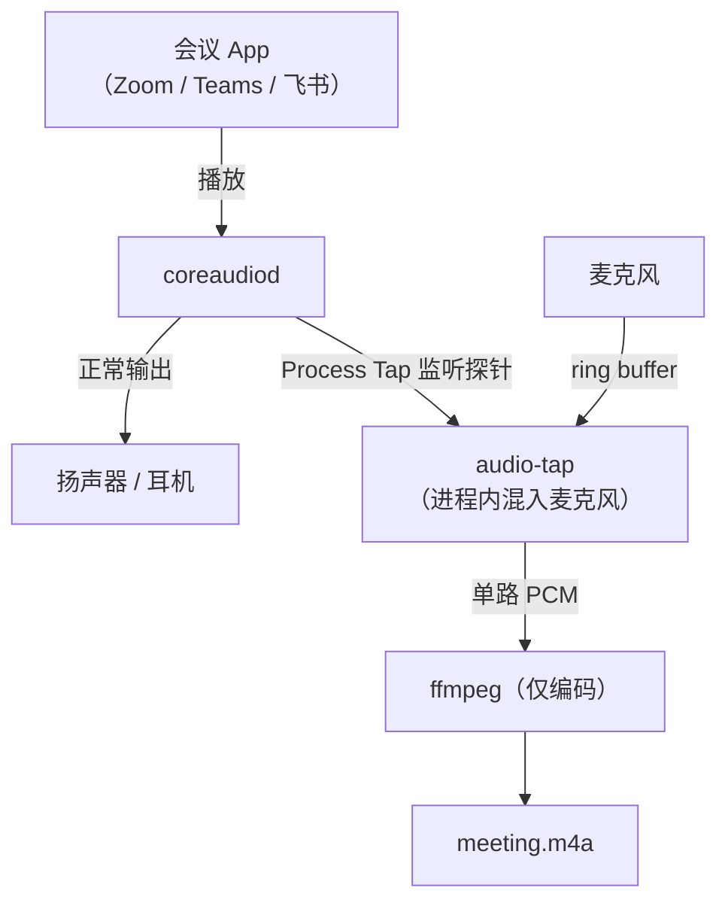
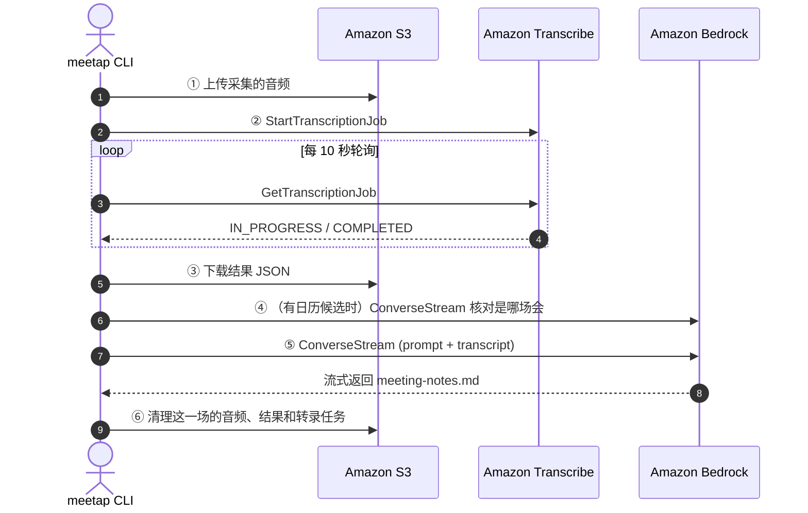

# MeeTap 实现原理

> 从 README 挪过来的。用 meetap 不需要读这一页；想知道声音是怎么录下来的、云上走了哪几步，再来看。

## 一、音频采集：Process Tap

macOS 不允许 App 直接抓取其他 App 的音频输出。MeeTap 用系统原生的 [Core Audio Process Tap](https://developer.apple.com/documentation/coreaudio)（macOS 14.4 引入的 `AudioHardwareCreateProcessTap` + `CATapDescription`）采集：在 coreaudiod 的系统混音总线上接一根监听探针，在音频送往扬声器 / 耳机的同一条链路上旁路复制一份交给采集进程。采集的是全部系统音频，音频照常从原设备播放，听感不变。

麦克风在同一进程内混入（借鉴 meetily 的 ring-buffer 混音架构），ffmpeg 只做编码、不访问任何音频设备，没有设备抢占和枚举竞态。

相较 1.x 用过的 BlackHole 虚拟声卡方案（2.0 已删除），它的优点是：

- **不用装、不用配**：系统自带，不装虚拟声卡、不用 `sudo killall coreaudiod`、不用在会议 App 里改扬声器；
- **不改默认输出设备**：照常从原扬声器 / 耳机听原声，不存在"录制期间误切输出就没声"的坑；
- **进程内混麦、不抢设备**：麦克风在 audio-tap 进程内混入，ffmpeg 只负责编码；
- **拿到真实采样率**：直接读 tap 的实际格式（`kAudioTapPropertyFormat`），不依赖设备标称率，避免时长错拉与音调失真。

**边录边落盘**：ffmpeg 写分片 MP4，每 10 秒切一片、写完马上刷到磁盘（`-frag_duration 10000000 -flush_packets 1`，见 `src/meetap` 的 `FFMPEG_MUX_ARGS`）。进程被强杀或断电，最多丢最后 10 秒。1.7.0 到 2.0 之前只用了 `frag_keyframe`，它只在视频关键帧处切片，纯音频整场攒在内存里，录音过程中文件一直是 32 字节。

**防漏录**：Process Tap 偶尔会"回调照常、交出的数据全是零"（实测录到第 19 分钟才坏）。audio-tap 每秒检查 tap 这一路：连续 3 秒全零记一个零段，恢复时记结束；同一零段里累计 20 秒有别的 App 在放声音，就弹通知。是否"在放声音"按 CoreAudio 的进程输出状态判断，配置 `zero_alert_ignore` 里的 App 不算。排障细节见 [tap-静默空录排障.md](tap-静默空录排障.md)。

## 二、云端处理：客户端直连托管服务

音频采集到本地后，meetap 命令行是唯一的控制面，在一次 `meetap stop` 的后台流程里：上传、转录、生成纪要、（可选）发邮件、清理。没有 Lambda、没有常驻基础设施，账户里不留临时资源。例外：凭证、网络一直没恢复而放弃时，这一场的音频和转录任务先留在 AWS 上，等 `meetap again` 接着用，用完再清；清的时候只删这一场自己的文件（所有会话共用一个桶）。

**架构组成**（谁在哪、谁管什么）：

没有 VPC、没有集群、没有自建服务器——几个托管服务通过 SDK / CLI 直接调用。

**调用顺序**（一次完整流程）：

流式返回让纪要边生成边出来，而不是等几十秒才一次性出现。生成纪要时如果流在中途断了（只吐了前半段），会整段重发，最多 3 次，排障见 [bedrock-纪要断流排障.md](bedrock-纪要断流排障.md)。

**每一步失败了都会等**：查凭证、上传、查进度、下载、认日历、生成纪要、发邮件，遇到凭证过期、网络断了，间隔从 10 秒起逐次翻倍（最长 2 分钟）一直重试，每一步各自最多等 15 分钟；别的报错试 3 次就停。代码在 `src/meetap` 的 `_retry`。
