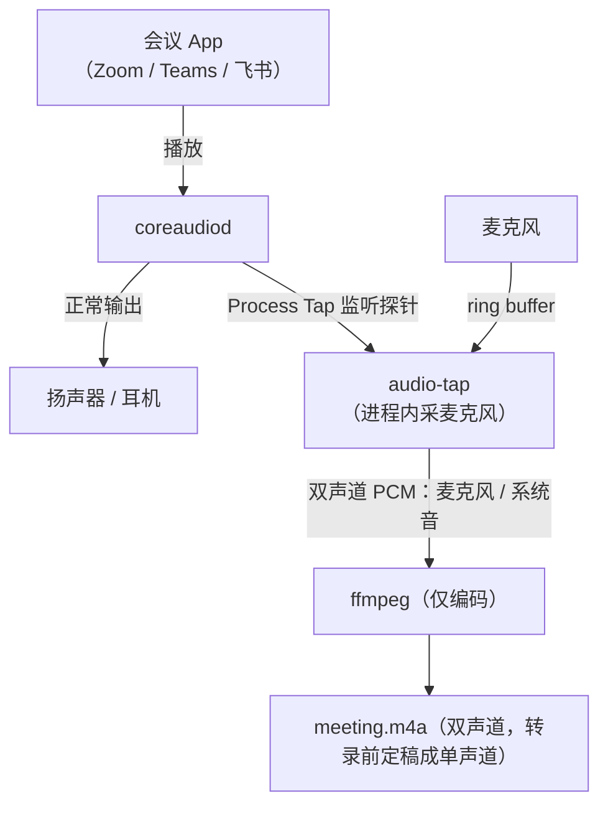
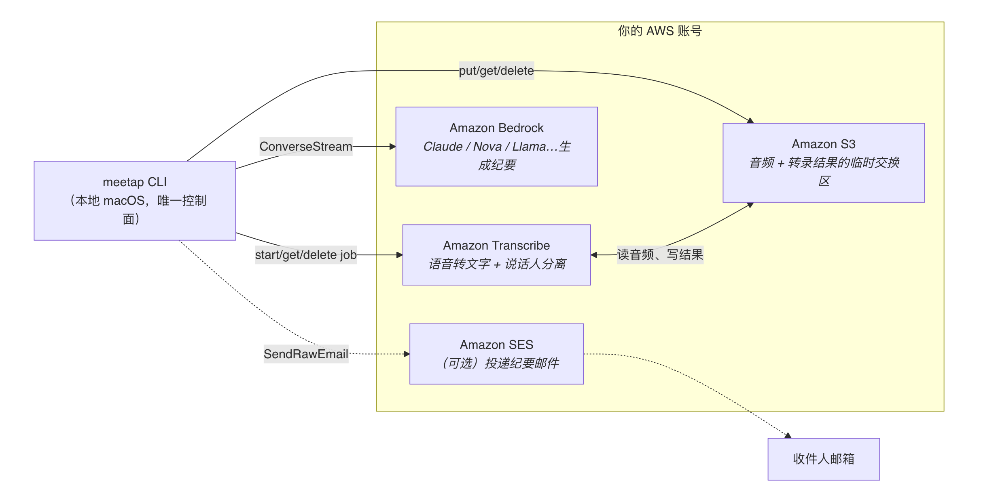
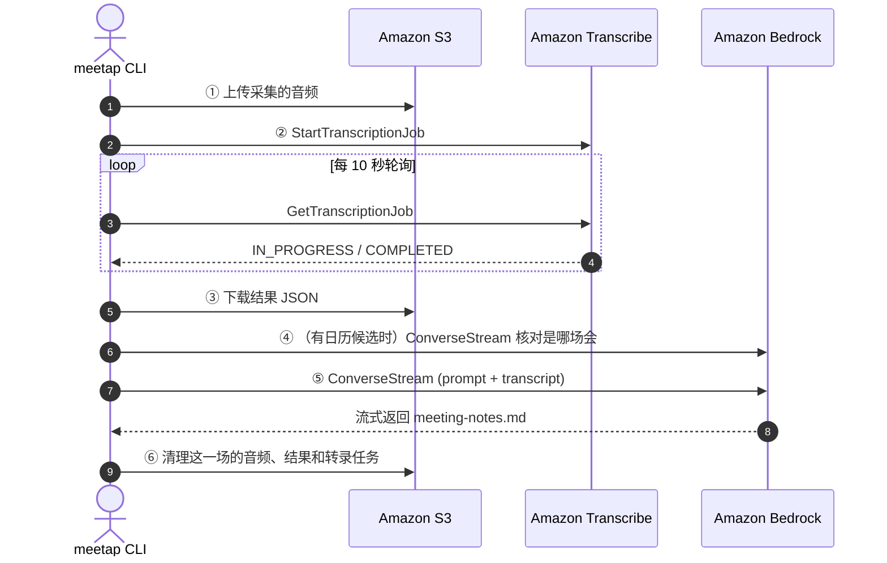

# MeeTap 实现原理

> 从 README 挪过来的。用 meetap 不需要读这一页；想知道声音是怎么录下来的、云上走了哪几步，再来看。

## 一、音频采集：Process Tap

macOS 不允许 App 直接抓取其他 App 的音频输出。MeeTap 用系统原生的 [Core Audio Process Tap](https://developer.apple.com/documentation/coreaudio)（macOS 14.4 引入的 `AudioHardwareCreateProcessTap` + `CATapDescription`）采集：在 coreaudiod 的系统混音总线上接一根监听探针，在音频送往扬声器 / 耳机的同一条链路上旁路复制一份交给采集进程。采集的是全部系统音频，音频照常从原设备播放，听感不变。

麦克风在同一进程内采（借鉴 meetily 的 ring-buffer 架构），和系统音各占一个声道写出：声道 0 麦克风，声道 1 系统音，录音时不混，转录前再定稿成单声道（见下面的「会议室回声」）。ffmpeg 只做编码、不访问任何音频设备，没有设备抢占和枚举竞态。加了 `-m` 不开麦，就只有系统音一个声道。

相较 1.x 用过的 BlackHole 虚拟声卡方案（2.0 已删除），它的优点是：

- **不用装、不用配**：系统自带，不装虚拟声卡、不用 `sudo killall coreaudiod`、不用在会议 App 里改扬声器；
- **不改默认输出设备**：照常从原扬声器 / 耳机听原声，不存在"录制期间误切输出就没声"的坑；
- **进程内采麦、不抢设备**：麦克风在 audio-tap 进程内采，ffmpeg 只负责编码；
- **拿到真实采样率**：直接读 tap 的实际格式（`kAudioTapPropertyFormat`），不依赖设备标称率，避免时长错拉与音调失真。

**边录边落盘**：ffmpeg 写分片 MP4，每 10 秒切一片、写完马上刷到磁盘（`-frag_duration 10000000 -flush_packets 1`，见 `src/meetap` 的 `FFMPEG_MUX_ARGS`）。进程被强杀或断电，最多丢最后 10 秒。1.7.0 到 2.0 之前只用了 `frag_keyframe`，它只在视频关键帧处切片，纯音频整场攒在内存里，录音过程中文件一直是 32 字节。

**防漏录**：Process Tap 偶尔会"回调照常、交出的数据全是零"（实测录到第 19 分钟才坏）。audio-tap 每秒检查 tap 这一路：连续 3 秒全零记一个零段，恢复时记结束；同一零段里累计 20 秒有别的 App 在放声音，就弹通知。是否"在放声音"按 CoreAudio 的进程输出状态判断，配置 `zero_alert_ignore` 里的 App 不算。排障细节见 [tap-静默空录排障.md](tap-静默空录排障.md)。

**会议室回声**：人在会议室、笔记本也进了会，会议室设备（Teams Room 之类）也在会里时，会议室里的人声麦克风实时录到一遍；会议室设备把它传上去，会议 App 再从笔记本放出来，又录到一遍，晚 1~2 秒。两遍混在一起像回声，转录也会乱。这种会上电脑的声音里已经有会议室里的人（经会议室设备的麦克风）和远端的人，去掉麦克风（等于开了 `-m`）就干净了。代价是会议室设备没收到的人，录音里也没有。

所以录音时两路分开存，转录前由 `src/meetap` 的 `_echo_check` 整场下一个结论，`_finalize_audio` 再把双声道录音原地换成单声道：认出会议室设备就只留电脑的声音，否则两路相加（和以前一样）。

判错的代价不对称。普通线上会戴耳机，也是两路都有声，但自己的话一般只在麦克风里（会议 App 不会把你自己的声音放回来；远端回声消除没做干净时，会漏回来小声的一遍）。误判成会议室会议，自己的话就没了；漏判只是照旧有回声。所以下面每一条都要满足，拿不准一律两路相加：

- 两路各算 20 毫秒一帧的能量包络，切成互不重叠的 30 秒段，每段找电脑的声音比麦克风晚 0.2~3 秒里哪一处最像。开外放时麦克风里会有电脑声音几十毫秒后的漏音，电脑声音自己的节奏（音乐、说话的节拍）会让别的延迟也显得像，判断前先把这部分扣掉。
- 至少 3 段像（偏相关 ≥ 0.4），延迟都对得上（相差不到 0.16 秒，同一条路延迟稳定）。
- 延迟的那一遍要和远端的人说话一样响，最多低 3 dB。会议 App 把每个人调到差不多的音量，会议室设备那一路和远端的人一样响。远端回声消除没做干净时漏回来的你自己的声音，就算很响也要低 6 dB，一般低 20 dB 上下，靠这一条挡掉。远端几乎没人说话、没得比时，也算不过关。
- 逐帧数副本：麦克风有声的每一帧，前后约半秒在电脑的声音里晚那么多也像、够响，增益也和大多数帧一致，才算有副本（麦克风录到的会议室音箱、笔记本外放的声音也算）。只看「这一段像不像」不够：隔壁同事的笔记本也在会里、会议室那一遍时有时无时，有副本的声音会把没副本的话盖住。
- 一段过关，要麦克风有声的帧按帧数、按能量都 90% 以上有副本。按能量算，是因为你自己离麦克风最近、最响；你在这一段里说了不少没有副本的话，这一段就过不了。但一段 30 秒里只有一两秒没副本的话，还在那 10% 以内，这一段照样过关，这几秒跟着去掉。从第一段过关的到最后一段过关的这个时段里，同样要 90% 以上有副本、有副本的合计 ≥ 30 秒，才判成会议室会议。至少要 3 段各有 3 秒以上麦克风说话，所以 1 分钟以内的录音不会判成会议室会议。
- 判成以后，也只在过关的段（30 秒一段）里去掉麦克风，别的段照常两路相加：没过关的段（比如隔壁同事的笔记本也在会里时，你说得多的那几段）、麦克风没什么声音没看的段、会议室设备进会以前和退会以后。进会、退会那一刻落在某一段中间、那一段又过了关时，那一段里麦克风多录到的一点会跟着去掉。

结论、延迟、相关、音量差、对得上的段数和覆盖写进会话的 `log/meetap.log`（🔁 开头那一行）；认出会议室设备时弹通知，结论另存一份在 `.meetap/echo-check.txt`。

已知问题：

- 旁边同事的笔记本也在同一个会里、开着麦克风时，同事的声音在你的麦克风里，又从电脑的声音里放出来，看着就像会议室设备那一路。同事说得多、你只说几句时，会判成会议室会议，你说的一两秒的短句可能跟着所在的段一起去掉（合成测试里，同事在你麦克风里低 3~10 dB、和你叠着说时会这样；低 16 dB 以上没事）。同一个会只让一台笔记本开着麦克风。按「一段里有一句没副本的话就不过关」改过，会议室会议能去掉的部分从九成多降到三到六成，同事很响时也还会丢，所以没这样做。
- 会议室设备那一路比远端的人小声 3 dB 以上时认不出来，照旧有回声。
- 会议室设备的延迟中途变了（比如从 1.2 秒变成 1.6 秒），只有其中一种延迟的那部分算数，另一部分照旧两路相加。
- 远端回声比远端的人低不到 3 dB、而且整场都有时，会被当成会议室设备，你的麦克风会被去掉（电脑的声音里你的话还在，只是小声、带回声）。
- 会议室设备进会、退会那一刻落在 30 秒段中间时，那一段里麦克风多录到的一点会跟着去掉。
- 你离笔记本麦克风比会议室里别的人近 12 dB 以上（比如你坐在笔记本前说话，别人都在远处）时，各人的增益差得太多，逐帧对不上，认不出来，照旧有回声。
- 判断的门槛都是用合成音频定的，还没在真实会议室里校准过。

定稿不丢录音：先写临时文件，刷到磁盘上，再原子替换；时长不变，转录结果的时间戳和录音对得上，以后按时间戳剪片段也不会错位。默认不留原始双声道录音，会话文件夹和以前一样大。配置 `keep_stereo_original = true` 时，认出会议室设备就把原始录音留在 `.meetap/`（每小时约 58 MB）；判错了就设 `echo_check = off` 再 `meetap again`，用它重做两路相加、从头转录。没留原始录音的，麦克风那一路就没了，`again` 会照实说。

开麦录的每一场转录前都要重新编码成单声道（`echo_check = off` 时也要，只是不查、直接两路相加）。一小时的录音在 M 系列 Mac 上实测：查回声约 6~7 秒，重新编码约 10~20 秒。`-m` 录的、老版本录的单声道录音两样都不做，原样上传。

## 二、云端处理：客户端直连托管服务

音频采集到本地后，meetap 命令行是唯一的控制面，在一次 `meetap stop` 的后台流程里：上传、转录、生成纪要、（可选）发邮件、清理。没有 Lambda、没有常驻基础设施，账户里不留临时资源。例外：凭证、网络一直没恢复而放弃时，这一场的音频和转录任务先留在 AWS 上，等 `meetap again` 接着用，用完再清；清的时候只删这一场自己的文件（所有会话共用一个桶）。

**架构组成**（谁在哪、谁管什么）：

没有 VPC、没有集群、没有自建服务器——几个托管服务通过 SDK / CLI 直接调用。

**调用顺序**（一次完整流程）：

流式返回让纪要边生成边出来，而不是等几十秒才一次性出现。生成纪要时如果流在中途断了（只吐了前半段），会整段重发，最多 3 次，排障见 [bedrock-纪要断流排障.md](bedrock-纪要断流排障.md)。

**每一步失败了都会等**：查凭证、上传、查进度、下载、认日历、生成纪要、发邮件，遇到凭证过期、网络断了，间隔从 10 秒起逐次翻倍（最长 2 分钟）一直重试，每一步各自最多等 15 分钟；别的报错试 3 次就停。代码在 `src/meetap` 的 `_retry`。
